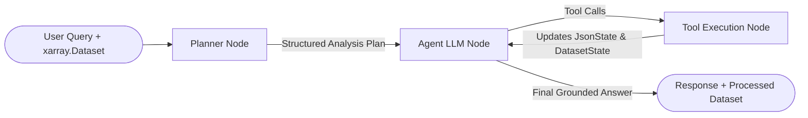

<p align="center">
  
</p>

<h1 align="center">ClimAgent</h1>
<p align="center">
  <strong>AI Autonomous Agent for Climate Data Analysis</strong>
</p>

<p align="center">
  
  
  
  
  
</p>

> **Archive Notice:** This repository contains a research prototype developed at **Politecnico di Torino** and is now archived for portfolio and reference purposes.

---

## Overview

**ClimAgent** is an LLM-driven autonomous agent designed to bridge natural language reasoning and multidimensional climate datasets (**NetCDF** and **Zarr** via `xarray`).

Climate datasets (such as CMIP6 projections or ERA5 reanalyses) are notoriously complex to inspect directly with Large Language Models due to their multi-dimensional structure, diverse coordinate systems, domain-specific metadata, and massive file sizes. Passing raw numerical arrays into an LLM context window is both computationally prohibitive and prone to hallucinations.

**ClimAgent** addresses this challenge by separating **metadata exploration** from **data manipulation**:
1. It constructs a lightweight, dynamically synchronized **JSON representation (`JsonState`)** of the `xarray.Dataset` metadata (`attrs`, `coords`, `data_vars`) without loading the raw data arrays into the prompt.
2. It uses a **LangGraph plan-and-execute architecture** where a **Planner node** decomposes the user's scientific query into a sequential execution plan before an **Executor LLM node** invokes specialized `xarray` tools to slice, resample, and aggregate the underlying dataset (`DatasetState`).
3. Only once the dataset has been reduced to the target subset/statistics does the agent inspect the numerical values to formulate a grounded natural language answer.

---

## Architecture & Workflow

ClimAgent is built on **LangGraph** (`StateGraph`) and maintains two synchronized state objects throughout execution:

- **`JsonState`**: Wraps a `JsonSpec` dictionary containing dataset attributes, coordinates, and variable descriptions. It updates automatically after every dataset transformation so the agent always inspects the current shape and metadata.
- **`DatasetState`**: Holds the live `xarray.Dataset` instance, applies in-memory/lazy `xarray` operations, and records a step-by-step audit trail (`history`) of all transformations performed.



### Available Agent Tools

| Tool Name | Category | Description |
| :--- | :--- | :--- |
| `json_spec_list_keys` | Metadata Inspection | Navigates keys incrementally inside the dynamic JSON schema (`attrs`, `coords`, `data_vars`). |
| `json_spec_get_value` | Metadata Inspection | Retrieves specific metadata values, units, coordinate bounds, or variable descriptions. |
| `select_variables` | Indexing & Selection | Filters the `xarray.Dataset` to retain only relevant climate variables (e.g., `tasmax`, `hd30`, `hi`). |
| `subset_dataset` | Indexing & Selection | Slices or selects nearest values across spatial, temporal, or scenario coordinates (e.g., `lat`, `lon`, `time`, `scenario`). |
| `resampletime_dataset` | Temporal Grouping | Resamples time-series dimensions to custom frequencies (`*YE`, `*M`, `*W`, `*D`, `*H`). |
| `aggregate_dataset` | Statistical Reduction | Reduces dimensions using statistical aggregations (`mean`, `max`, `min`, `median`, `sum`, `std`, `var`, `prod`, `cumsum`, `cumprod`). |
| `look_dataset` | Data Inspection | Extracts the final reduced numerical data from the `xarray.Dataset` (with automatic truncation safeguards) to answer the user query. |

---

## Repository Structure

```text
climagent/
├── img/
│   └── logo_chatgpt.png                # Project logo
├── notebooks/
│   ├── climagent CCKP.ipynb            # Demo: CMIP6 heatwave hazard analysis (Zarr)
│   └── climagent ERA + Lida.ipynb      # Demo: ERA5 time-series retrieval + LIDA visualization
├── src/
│   ├── climagent/
│   │   ├── agent/
│   │   │   ├── climagent.py            # Core ClimAgent class & LangGraph state machine
│   │   │   ├── prefix.py               # System instructions & JSON exploration rules
│   │   │   └── suffix.py               # Dynamic top-level schema injection
│   │   ├── state/
│   │   │   ├── agent_state.py          # LangGraph message state definition
│   │   │   ├── dataset_state.py        # xarray.Dataset wrapper & operation history
│   │   │   └── json_state.py           # Dynamic metadata JSON spec synchronization
│   │   └── tools/
│   │       ├── json_tools.py           # Custom dynamic JSON inspection tools
│   │       ├── xarray_tools_indexing.py    # Variable selection & coordinate subsetting
│   │       ├── xarray_tools_grouping.py    # Temporal resampling tools
│   │       ├── xarray_tools_aggregating.py # Multi-dimensional statistical aggregations
│   │       └── xarray_tools_look.py        # Final numerical value inspection
│   └── utils.py                        # LLM initialization & deterministic evaluation helpers
├── pyproject.toml
├── requirements.txt
├── VERSION
└── LICENSE
```

---

## Installation & Setup

1. **Clone the repository and install in editable mode:**
   ```bash
   git clone https://github.com/JGrassi97/climagent.git
   cd climagent
   pip install -r requirements.txt
   pip install -e .
   ```

2. **Configure environment variables:**
   Create a `credentials.env` file in the project root with your Azure OpenAI (or OpenAI-compatible) credentials:
   ```env
   GPT_DEPLOYMENT_NAME=your-deployment-name
   OPENAI_API_VERSION=2024-02-15-preview
   OPENAI_API_KEY=your-api-key
   AZURE_ENDPOINT=https://your-endpoint.openai.azure.com/
   ```

---

## Quick Start & Example Workflows

### 1. Assessing Future Heatwave Hazards (CMIP6 / CCKP Zarr Store)

See [`notebooks/climagent CCKP.ipynb`](notebooks/climagent%20CCKP.ipynb) for the complete interactive walkthrough.

```python
import os
import xarray as xr
from dotenv import load_dotenv
from langchain_core.messages import HumanMessage
from langchain_openai import AzureChatOpenAI
from climagent.agent.climagent import ClimAgent

load_dotenv("credentials.env")

# 1. Initialize the LLM
llm = AzureChatOpenAI(
    deployment_name=os.getenv("GPT_DEPLOYMENT_NAME"),
    openai_api_version=os.getenv("OPENAI_API_VERSION"),
    openai_api_key=os.getenv("OPENAI_API_KEY"),
    azure_endpoint=os.getenv("AZURE_ENDPOINT"),
    temperature=0,
)

# 2. Open a multi-dimensional climate dataset (NetCDF or Zarr)
dataset = xr.open_zarr("example_datasets/cckp/store/CMIP6_timeseries.zarr", decode_timedelta=True)

# 3. Initialize and run ClimAgent
agent = ClimAgent(dataset, llm)

query = (
    "I want to assess whether Rome is expected to experience heat wave conditions "
    "hazardous to the population in the period 2040-2060."
)
response = agent.run([HumanMessage(query)])

# 4. Inspect the grounded natural language response
print(response["messages"][-1].content)

# 5. Inspect the audit trail of xarray operations and the resulting dataset
print(agent.dataset_state.history)
processed_ds = agent.dataset_state.dataset
```

**What happens under the hood:**
- The agent inspects available variables in `JsonState` and autonomously selects relevant heat indicators (`tasmax`, `hd30`, `hd35`, `hi`).
- It subsets the spatial coordinates nearest to Rome (`lat`, `lon`), slices the `2040-2060` time window, aggregates across ensemble percentiles/time, and compares projections across SSP scenarios (`SSP1-2.6`, `SSP2-4.5`, `SSP5-8.5`).

### 2. ERA5 Reanalysis Retrieval & Automated Plotting with LIDA

See [`notebooks/climagent ERA + Lida.ipynb`](notebooks/climagent%20ERA%20%2B%20Lida.ipynb), which demonstrates:
- Fetching ERA5 time-series data directly from the Copernicus Climate Data Store (CDS) via `earthkit-data`.
- Using **ClimAgent** to filter temperature variables and resample the dataset to yearly series.
- Passing the resulting `agent.dataset_state.dataset.to_dataframe()` into **Microsoft LIDA** to automatically synthesize trend plots with linear regression parameters and physical units.

---

## Evaluation Methodology

To quantitatively evaluate the reliability and efficiency of the agent on multi-step climate queries, the project includes a deterministic benchmarking pipeline (see `src/utils.py`):

- **Deterministic Ground Truth (`deterministic_process_dataset`)**: Executes the reference sequence of `xarray` tool calls for a benchmark query and stores the resulting reference `xarray.Dataset`.
- **Success Rate (SR)**: Checks exact dataset equivalence (`dataset_ref.equals(dataset_agent)`) between the dataset produced autonomously by `ClimAgent` and the ground-truth dataset.
- **Repetition Rate (RR)** *(following AgentQuest, Gioacchini et al., 2024)*: Tracks tool invocation frequencies across the trajectory to detect redundant or looping tool calls.
- **Optimal Flow Comparison**: Compares the agent's executed tool trajectory against the minimum required sequence of operations.

---

## Author & License

- **Author:** Jacopo Grassi (*Politecnico di Torino*) — `jacopo.grassi@polito.it`
- **License:** Distributed under the [GNU Affero General Public License v3.0 (AGPL-3.0)](LICENSE).

